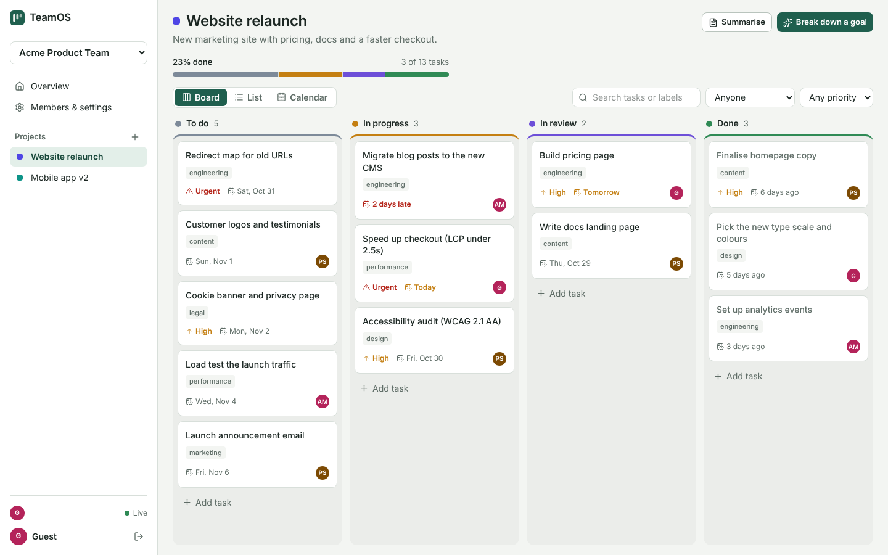
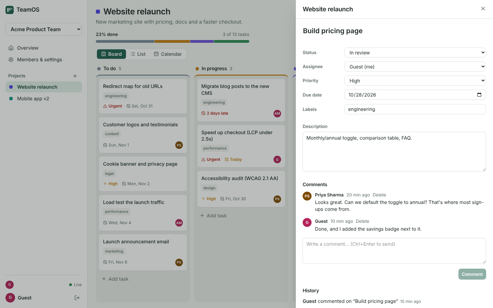
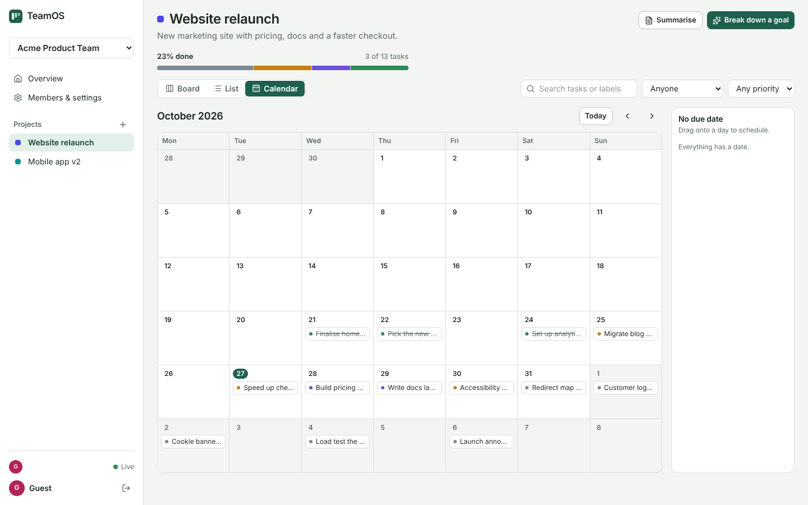
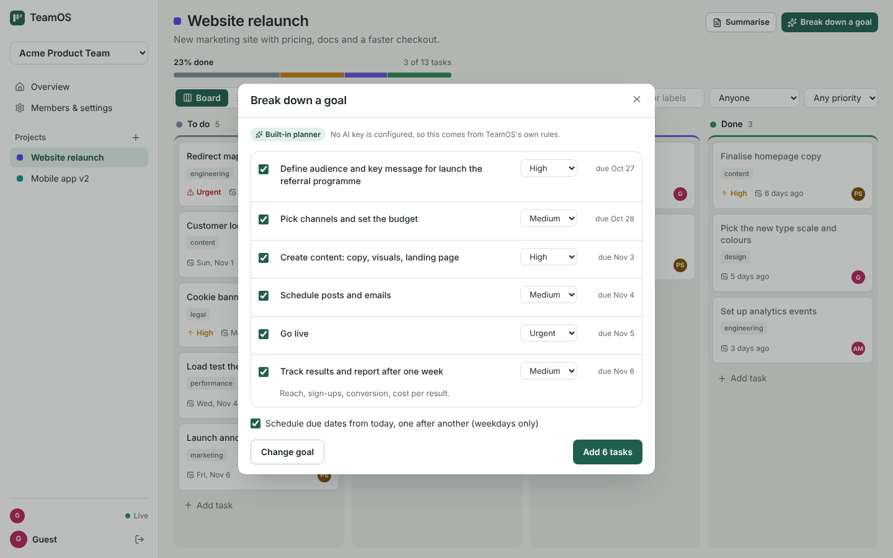
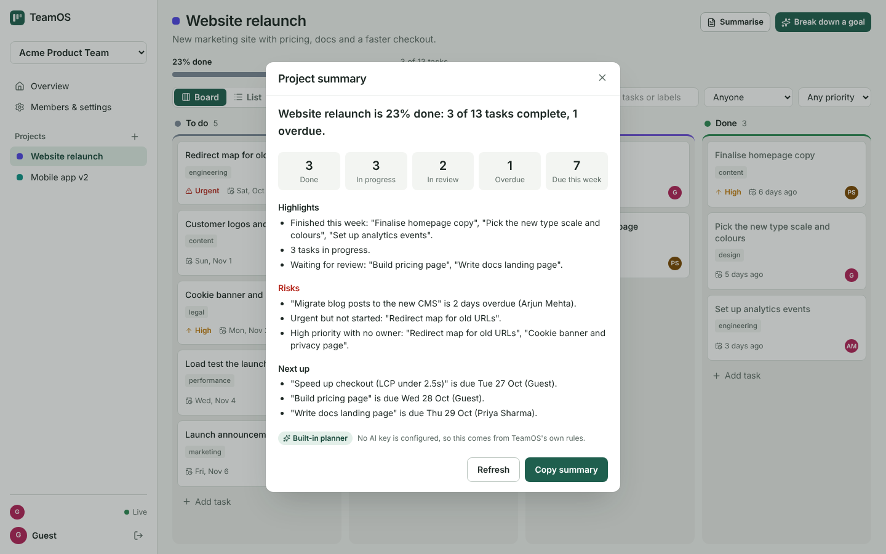
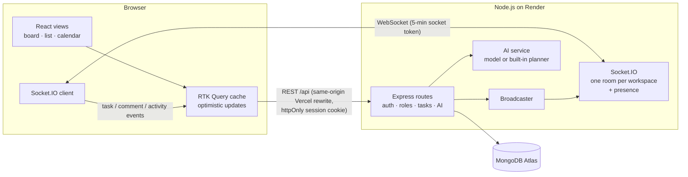

# TeamOS — a live workspace for small teams

Projects, a drag-and-drop Kanban board, a list and a calendar that the whole team edits **at the same time**, with comments, an activity feed, roles, and AI help to break a goal into tasks, summarise a project and draft your daily standup.

**Live demo:** [teamos-liart.vercel.app](https://teamos-liart.vercel.app) · click **“Try the demo”**: you get your own team workspace with two teammates and work in progress, no sign-up.

> The API runs on a free host that sleeps when idle, so the first visit can take up to a minute to wake it. The page shows a progress message while that happens.



## What it does

| | |
|---|---|
| **Board, list and calendar** | Drag cards between columns (mouse, touch or keyboard), sort a list by any column, or drag a task to another day on the calendar. Filters (text, assignee, priority) live in the URL. |
| **Live for everyone** | Moves, edits, comments and new tasks appear for teammates instantly. Avatars show who is looking at which project; the connection status shows Live / Reconnecting. |
| **Edits never silently overwrite** | Every task has a version. If two people edit the same task, the second save gets `409` and their screen shows the newer version instead of overwriting it. |
| **Roles that hold** | Owner, admin, member, viewer. Checked on the server for every request; workspaces you're not in return `404`, so ids can't be probed. |
| **AI planning** | *Break down a goal* suggests 4–8 tasks you can edit and pick, then schedules due dates on weekdays. *Summarise* and *Your standup* are written from the project's real tasks and activity. |
| **Invite links** | Share a link to join as a member; admins can reset it to lock out old links and change roles afterwards. |

| | |
|---|---|
|  |  |
|  |  |

## Tech stack

**Frontend:** React 19, TypeScript, Vite, Redux Toolkit + RTK Query, dnd-kit, Socket.IO client, React Router 7, Tailwind CSS 4, Vitest + Testing Library, Playwright.
**Backend:** Node.js, Express 5, Socket.IO, MongoDB + Mongoose, JWT (httpOnly cookie), bcrypt, Zod, Helmet, express-rate-limit.
**AI:** Anthropic or OpenAI (optional, your own key), with a built-in rule-based planner when no key is set.
**Infra:** Vercel (web app), Render (API + WebSockets), MongoDB Atlas, GitHub Actions CI.

## Architecture



### How the board stays consistent

- **Fractional ordering.** Each card stores an `order` number. Dropping a card between two others sets it to their midpoint, so a drag writes **one row**, not the whole column. If repeated drops leave no room between two neighbours, the column is re-spaced once (covered by a test that does 60 drops into the same gap).
- **Optimistic UI with rollback.** RTK Query applies a move or edit immediately using the same ordering rule as the server, and rolls it back if the request fails.
- **Versioned edits.** `PATCH /api/tasks/:id` must include the version the client saw; MongoDB applies it with one atomic `findOneAndUpdate({ _id, version })`. A stale edit returns `409 STALE` with the current task, which the client shows with a short notice.
- **Late echoes are ignored.** Realtime updates replace the cached task only if their version is at least as new, so an old event arriving late can't undo a newer change.
- **Reconnects resync.** After a dropped connection the client rejoins its workspace and refetches tasks, comments and activity.

### How the AI is kept honest

- The AI only **suggests**. Nothing is created until you pick tasks and click *Add*.
- Prompts mark the user's goal and the project data as **data, not instructions**, and escape closing tags inside them.
- Every reply is parsed and **validated with Zod**; tasks the project already has are dropped.
- Summaries and standups are written from computed facts, and are **discarded if they contain a number that isn't in those facts** (so the model can't invent "90% done").
- Rate limits: 20 AI requests per minute per IP and a per-user daily cap on model calls. If there's no key, the cap is reached, or a reply fails validation, the built-in planner answers instead and the UI says so ("Built-in planner" vs "Written by AI").

### Security

- Session JWT in an **httpOnly, SameSite=Lax cookie**; the web app calls the API through a same-origin Vercel rewrite, so no third-party cookies are needed. Sockets use a separate 5-minute token (`aud: socket`).
- Server-side role checks on every route; non-members get `404`. Removing a member unassigns their tasks and kicks their open sockets out of the workspace room.
- Zod-validated input, one JSON error shape with no stack traces, Helmet headers, per-IP auth rate limit, bcrypt passwords, login errors that don't reveal which emails exist, and same-site-only redirects after sign-in.

## Measured

| What | Result | How |
|---|---|---|
| Card move reaching 9 watching teammates | **p50 1.8 ms, p95 3.1 ms, p99 6.5 ms** (300 moves) | `npm run bench` in `server/` (local; excludes internet latency) |
| Rows written per drag-and-drop | **1** (re-space only when a gap runs out) | `api.test.ts` |
| Landing page JS (gzip) | **73 kB**; drag-and-drop (20 kB) and realtime (13 kB) load only inside the app | `vite build` |
| Automated tests | **44 server + 21 client unit + 8 end-to-end** | see below |

## Tests

```bash
cd server && npm test        # API, roles, ordering, version conflicts, realtime events, presence, AI (mocked model), store contract
cd client && npm test        # ordering & realtime merge, dates & scheduling, filters, components
cd client && npm run test:e2e  # Playwright: drag-and-drop (mouse + keyboard), two people live, AI breakdown, calendar, viewer read-only, mobile
```

The store contract tests run against the in-memory store locally and against a **real MongoDB** service container in CI.

## Run it locally

```bash
# API (in-memory store; set MONGODB_URI to use MongoDB, ANTHROPIC_API_KEY or OPENAI_API_KEY for real AI)
cd server && npm install && npm run dev        # http://localhost:4000

# Web app (proxies /api and /socket.io to :4000)
cd client && npm install && npm run dev        # http://localhost:5173
```

## Deploy

- **API → Render:** `render.yaml` (root `server/`, health check `/api/health`). Set `MONGODB_URI` and `CLIENT_ORIGIN` in the dashboard, and optionally `ANTHROPIC_API_KEY`.
- **Web app → Vercel:** root `client/`. `client/vercel.json` rewrites `/api/*` to the Render URL; set `VITE_SOCKET_URL` to the Render URL (here `https://teamos-api.onrender.com`).

## Known limitations

- Task descriptions are last-writer-wins per save (protected by the version check), not character-merged like a shared document.
- Calendar dates are plain days without time zones; the overdue cut-off uses the viewer's local date.
- No email notifications or file attachments yet.

## Project structure

```
client/   React app: pages, board/list/calendar views, task drawer, AI dialogs, RTK Query + realtime, Playwright e2e
server/   Express + Socket.IO API: auth, roles, tasks, comments, activity, AI service, Mongo/memory stores, tests, bench
docs/     screenshots
```
